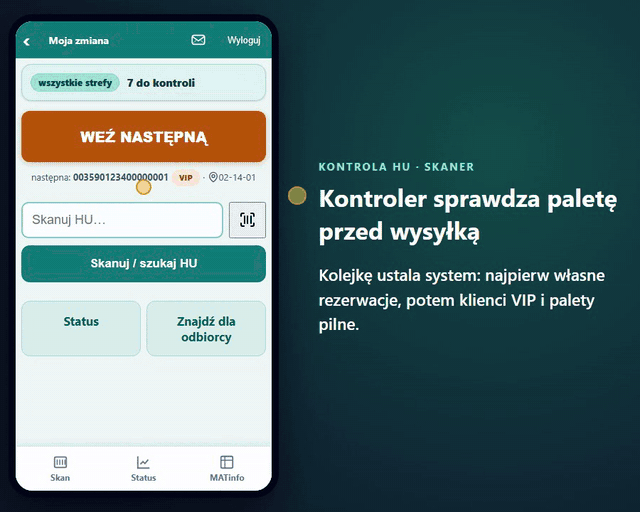
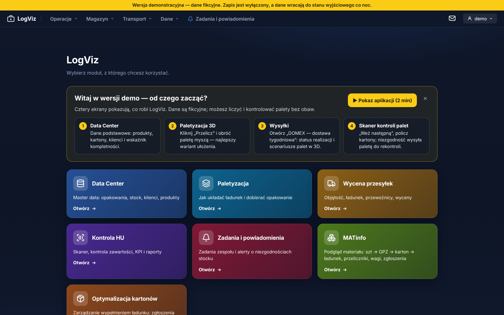
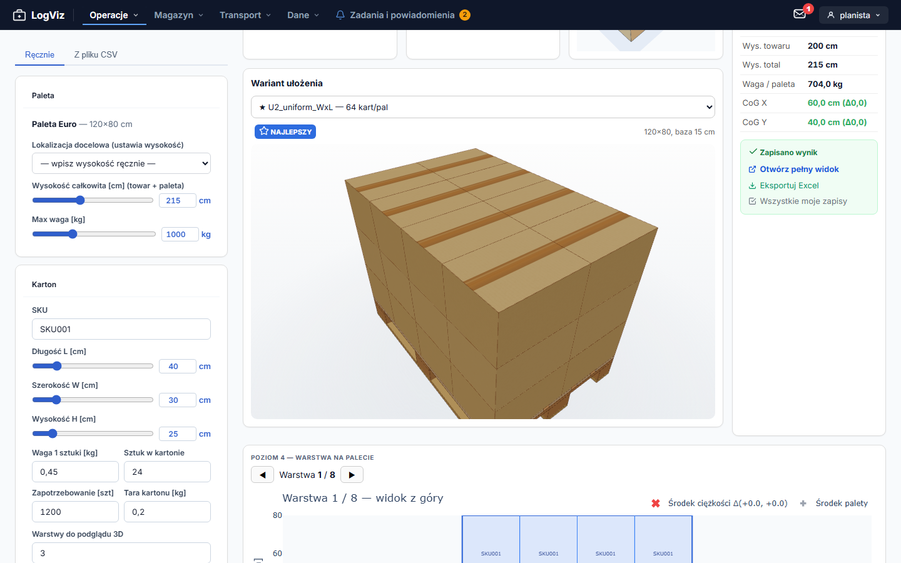
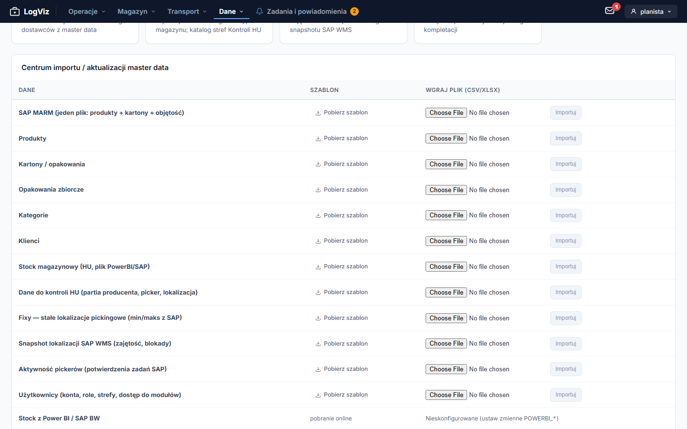
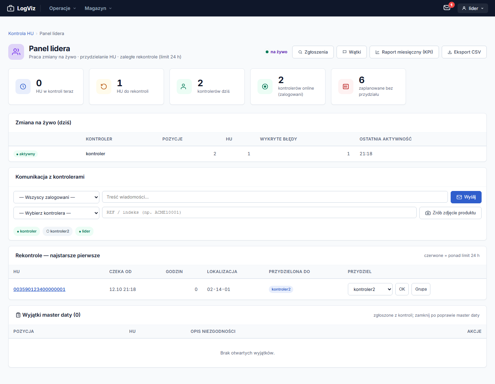

# LogViz

Wspólne narzędzie dla magazynu, transportu i obsługi klienta, które zastępuje rozproszone w Excelu
i SAP planowanie palet i wysyłek, kontrolę HU (palet z etykietą) i obraz magazynu.

[](https://github.com/TomaszWu14/palviz-public/actions/workflows/ci.yml)




📹 [Prezentacja działania — 2 min, bez lektora, z napisami](docs/video/logviz-demo.mp4)

**Demo online:** `<DO UZUPEŁNIENIA: https://logviz.twapp.pl>`. Kliknij **Wejdź jako demo**, nie trzeba
zakładać konta. Dane są fikcyjne, zapis jest wyłączony, a co noc wszystko wraca do stanu wyjściowego.
Po zalogowaniu hub pokazuje 4 kroki „od czego zacząć” i przycisk pokazu z lektorem (2 min).

> **Projekt portfolio.** Nazwy firm są zamienione na fikcyjne (ACME, DOMEX, przewoźnicy PACZKI /
> PALETY / BUS / EXPORT, magazyn zewnętrzny ZEW), a dane demo i testowe są syntetyczne.

## Problem → rozwiązanie

Planowanie palet i wysyłek, kontrola HU i obraz magazynu były rozproszone w Excelu i SAP — nie było
wspólnego narzędzia dla magazynu, transportu i obsługi klienta. LogViz to jedna aplikacja webowa z
hubem modułów zależnych od roli: dane podstawowe (Data Center), paletyzacja na palecie EU 120×80 z
widokiem 3D, wycena przesyłek z ofertami przewoźników oraz kontrola zawartości palet na skanerach
przed załadunkiem. SAP pozostaje źródłem danych tylko do odczytu — wynik kontroli, zadania i
powiadomienia żyją w aplikacji, a paleta z błędem trafia do rekontroli, którą wykonuje inna osoba.

## Ekrany

| Hub modułów (zależny od roli) | Paletyzacja 3D |
|---|---|
|  |  |
| **Data Center — centrum importów** | **Panel lidera — rekontrole** |
|  |  |

## Dokumentacja analityczna

| Dokument | Zawartość |
|---|---|
| [01 Problem i zakres](docs/01-problem-i-zakres.md) | Problem, interesariusze i 9 ról, moduły w zakresie i poza nim. |
| [02 Proces](docs/02-proces.md) | Proces Kontroli HU: aktorzy, stany palety, punkty decyzyjne (diagramy Mermaid). |
| [03 User flow](docs/03-user-flow.md) | Mapa ekranów: logowanie i hub, skaner kontroli HU, planista, wycena. |
| [04 Model danych](docs/04-model-danych.md) | Diagramy ER, reguły integralności wymuszane przez bazę i niespójności. |
| [05 Wymagania](docs/05-wymagania.md) | 64 wymagania z kryteriami akceptacji „Zakładając / Gdy / Wtedy” i miejscem w kodzie/testach. |
| [06 Decyzje](docs/06-decyzje.md) | Dziennik decyzji: kontekst, opcje, uzasadnienie, skutki. |
| [07 Ograniczenia](docs/07-ograniczenia.md) | Czego świadomie nie ma i znane problemy (P1–P19). |
| [ADR](docs/adr/README.md) | 18 zapisów decyzji architektonicznych (pełna treść). |

## Jak uruchomić

**Wymagania:** Python 3.11+ (testowane na 3.13), Git. Na Windows sklonuj repo do krótkiej ścieżki
(np. `C:\dev\logviz`) — limit 260 znaków ścieżki potrafi wyłożyć instalację pakietów.

```bash
git clone https://github.com/TomaszWu14/palviz-public.git logviz && cd logviz
python -m venv .venv
source .venv/bin/activate              # Windows cmd: .venv\Scripts\activate
pip install -r requirements.txt
sh web/scripts/fetch_vendor.sh         # raz: biblioteki front-end (three.js, ECharts…), na Windows z Git Bash
cd web
export DJANGO_DEBUG=true               # Windows cmd: set DJANGO_DEBUG=true
python manage.py migrate
python manage.py create_roles          # 9 grup ról
DJANGO_SUPERUSER_PASSWORD=<hasło> python manage.py createsuperuser --noinput --username admin --email admin@example.com
python manage.py runserver 8080        # zajęty port? podaj inny, np. 8081
```

Windows cmd — tworzenie administratora (zmienna ustawiana osobno):

```bat
set DJANGO_SUPERUSER_PASSWORD=<hasło>
python manage.py createsuperuser --noinput --username admin --email admin@example.com
```

Otwórz <http://127.0.0.1:8080/login/>. `PYTHONPATH` nie jest potrzebny — `manage.py` sam dodaje
korzeń repo do ścieżki. Przy `DJANGO_DEBUG=true` zadania Celery wykonują się od razu (bez Redisa),
a baza to plik SQLite. Na Windows `setup.bat` (venv, pakiety, migracje, administrator interaktywnie)
i `run.bat` (serwer na porcie 8080) skracają te kroki; `create_roles` i `fetch_vendor.sh` uruchom osobno.

**Dane demo (opcjonalnie, tylko przy `DJANGO_DEBUG=true` — przy `false` obie komendy odmawiają):**

| Komenda | Co tworzy | Logowanie |
|---|---|---|
| `python manage.py seed_test_users` | 10 kont: po jednym na każdą z 9 ról + superuser | login = hasło, np. `test_kontrola` / `test_kontrola`, `test_lider`, `test_transport`, `test_md`, `test_super` |
| `python manage.py seed_testdata` | Persony testowe i dane domenowe: produkty, palety HU, wysyłki w różnych statusach; wymaga `pip install -r requirements-test.txt` | `p_<rola>` (np. `p_kontrola_hu`, `p_lider`, `p_transport`), hasło `Test-haslo-123` |

### Pokaz z lektorem (`?demo=1`)

Dopisz `?demo=1` do adresu dowolnej strony po zalogowaniu (np. jako planista z uprawnieniami
administratora), a potem kliknij **Rozpocznij prezentację**. Pokaz przechodzi sam przez 14 kroków:
hub, Data Center, paletyzację 3D, wysyłkę, skaner i panel lidera. Bez parametru nic się nie ładuje.

- Teksty i słownik wymowy: `web/ui/static/ui/demo/demo_script.json`, ustawienia głosu: `config/voice.json`.
- Nagrania: `ELEVENLABS_API_KEY=… ELEVENLABS_VOICE_ID=… python tools/generate_voiceover.py`.
  Generuje tylko zmienione kroki; `--dry-run` pokazuje plan, `--step krok03` przegenerowuje jeden krok,
  a `--all` wszystkie (np. po zmianie głosu).
- Bez nagrań pokaz czyta tekst syntezą mowy przeglądarki (pl-PL).

### Wersja demo lokalnie

```bash
cd web
export DJANGO_DEBUG=true DEMO_MODE=true      # Windows cmd: set DJANGO_DEBUG=true & set DEMO_MODE=true
python manage.py migrate && python manage.py create_roles
python manage.py seed_demo                   # fikcyjna firma ACME, klienci, wysyłki, 10 palet HU
python manage.py runserver 8080              # /login/ → „Wejdź jako demo”
```

`seed_demo --reset` przywraca stan wyjściowy. Bez `DEMO_MODE=true` komenda odmawia, bo reset kasuje wszystkie
wysyłki, produkty i klientów.

### Instancja demo w Coolify

1. Zmienne środowiskowe: `DEMO_MODE=true`, `DEMO_USER=demo` (domyślnie) i opcjonalnie `DEMO_PASSWORD`.
   Bez hasła konto wchodzi tylko przyciskiem; z hasłem login i hasło widać na ekranie logowania.
   Do tego zwykłe zmienne produkcyjne (`DJANGO_SECRET_KEY`, `DJANGO_ALLOWED_HOSTS`, `APP_NAME=LogViz`).
2. Pierwszy start: `docker-entrypoint.sh` przy `DEMO_MODE=true` sam uruchamia `create_roles` i `seed_demo`
   (oba są idempotentne).
3. Reset co noc: **Scheduled Tasks → Add**, kontener aplikacji, komenda
   `cd /app/web && python manage.py seed_demo --reset`, częstotliwość `0 3 * * *`.

Konto demo ma role Master Data, Transport, Kontrola HU i Lider kontroli, ale bez Administratorów.
Middleware (`web/core/demo.py`) blokuje mu każdy zapis poza przeliczeniem palety i przepływem
skanera. Zmiana hasła, wiadomości i panel administracyjny zwracają 403.

### Docker (konfiguracja produkcyjna)

```bash
export DJANGO_SECRET_KEY=<długi-losowy-klucz>     # Windows cmd: set DJANGO_SECRET_KEY=...
export DJANGO_ALLOWED_HOSTS=localhost,127.0.0.1
docker compose up --build                         # gunicorn + Redis
```

Aplikacja: <http://localhost:8000>. Kontener działa z `DJANGO_DEBUG=false`, więc obie zmienne
trzeba ustawić przed startem (pusty klucz nie jest dziś odrzucany — zob. [07, P16](docs/07-ograniczenia.md)).

### Testy

```bash
# Biblioteka pakowania (40 testów)
python -m unittest discover -s palletizer/tests -p "test_*.py"

# Django (z web/; 1943 testy)
pip install -r requirements-test.txt
cd web
DJANGO_SECRET_KEY=ci-test-secret DJANGO_DEBUG=true DJANGO_ALLOWED_HOSTS='*' \
  PYTHONPATH=.. python manage.py test ui.tests huctl.tests transport.tests -v 1
```

CI ([`.github/workflows/ci.yml`](.github/workflows/ci.yml)) uruchamia oba zestawy na PostgreSQL przy
każdym PR do `main`.

## Stack i dlaczego taki

- **Django 5.2 LTS jako modularny monolit z hubem modułów** — jeden deploy, jedna baza, wspólne
  uprawnienia i panel admina dla wielu małych modułów; bez kosztu SSO i API między serwisami
  ([ADR-0001](docs/adr/0001-modularny-monolit-hub-modulow.md)).
- **Silnik pakowania `palletizer/` w czystym Pythonie, bez frameworka** — testuje się szybko i
  działa też z CLI; OR-Tools (CP-SAT) jako opcjonalna ścieżka optymalnej warstwy
  ([ADR-0002](docs/adr/0002-palletizer-bez-django.md)).
- **SAP tylko do odczytu (pliki, Power BI)** — aplikacja nie może uszkodzić danych SAP; rozjazdy
  domyka proces (zadania), a nie automatyczna korekta ([ADR-0003](docs/adr/0003-sap-tylko-do-odczytu.md)).
- **Synchroniczny WSGI + Celery** do zadań w tle — prostszy model wykonania niż async
  ([ADR-0004](docs/adr/0004-synchroniczny-wsgi-celery.md)).
- **three.js / ECharts serwowane z własnej statyki, bez CDN** — UI działa przy awarii CDN i za
  restrykcyjną CSP ([ADR-0005](docs/adr/0005-vendorowane-biblioteki-bez-cdn.md)).
- **SQLite domyślnie, PostgreSQL w CI i gotowy do włączenia** — rozwój bez Postgresa, kod testowany
  na obu silnikach; przejście produkcji na Postgresa to decyzja właściciela ([ADR-0007](docs/adr/0007-sqlite-domyslnie-postgres-przygotowany.md)).
- **Konfiguracja typowana pydantic-settings z walidacją przy starcie** — brak lub błędna zmienna
  zatrzymuje start z jednym zbiorczym komunikatem zamiast błędu w środku żądania
  ([`web/palletweb/config.py`](web/palletweb/config.py)).
- **Nazwy 9 grup ról jako zamrożony kontrakt** — są wierszami w bazie i słownikiem mapowania SSO;
  pilnuje ich test ([ADR-0006](docs/adr/0006-nazwy-grup-rol-zamrozony-kontrakt.md)).
- **Docker + Coolify, CI na GitHub Actions** z szybką bramką testów i auto-merge przez PR
  ([ADR-0009](docs/adr/0009-szybka-bramka-ci.md), [ADR-0010](docs/adr/0010-auto-merge-claude-przez-pr.md)).

## Zakres i ograniczenia

Bez zapisu do SAP i integracji w czasie rzeczywistym, CSP tylko raportuje naruszenia, MFA dla
administratorów odłożone. Analiza kodu wykazała 19 znanych problemów (m.in. eskalacja po nieudanej
rekontroli nie odpala, pusty `DJANGO_SECRET_KEY` przechodzi walidację) — pełna lista:
[07 Ograniczenia](docs/07-ograniczenia.md).

## Kontekst projektu

`<DO UZUPEŁNIENIA przeze mnie>`

## Układ repo

```
main.py         CLI samodzielnego paletyzatora
palletizer/     biblioteka pakowania bez frameworka (geometria, domena, IO, wizualizacja)
web/            projekt Django `palletweb`: ui (rdzeń), huctl (Kontrola HU), transport, core
docs/           dokumentacja analityczna 01–07, ADR, procesy, runbooki
tests/          macierz uprawnień (tests/permissions.yaml — 326 tras)
```

Architektura: [`ARCHITECTURE.md`](ARCHITECTURE.md). Nazwy techniczne w kodzie (`palletweb`,
`palletizer`, GROOVE) zostały; nazwę wyświetlaną ustawia zmienna `APP_NAME`.

Kod do wglądu, wszelkie prawa zastrzeżone — [`LICENSE`](LICENSE).
