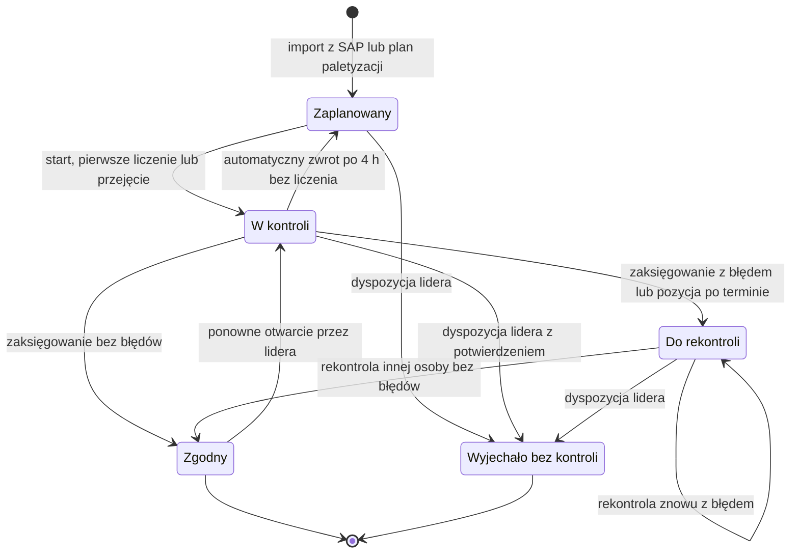
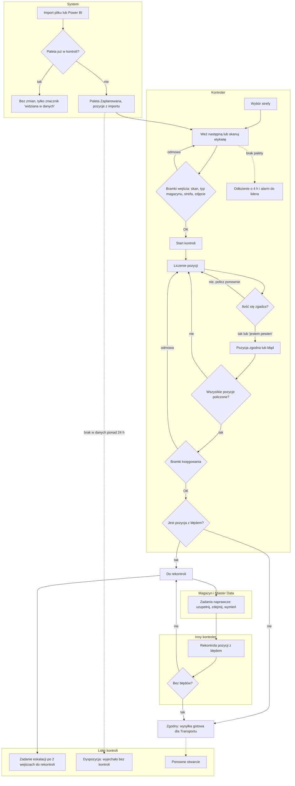
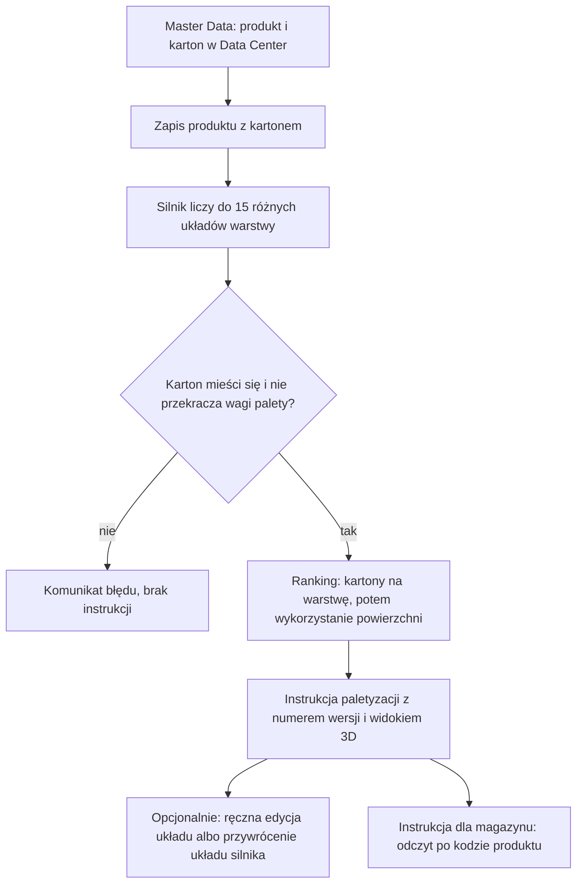
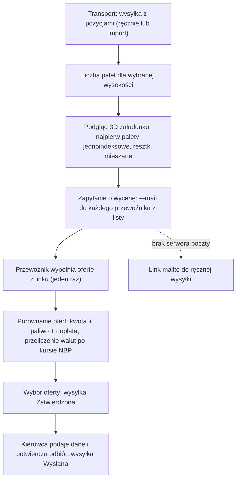

# 02. Proces biznesowy

Dokumentacja analityczna LogViz: [01 Problem i zakres](01-problem-i-zakres.md) · **02 Proces** ·
[03 User flow](03-user-flow.md) · [04 Model danych](04-model-danych.md) ·
[05 Wymagania](05-wymagania.md) · [06 Decyzje](06-decyzje.md) · [07 Ograniczenia](07-ograniczenia.md)

Opis odtworzony z kodu (stan gałęzi `portfolio-cleanup`). Wersja dla pracowników magazynu, bez
nazw technicznych: [procesy/kontrola-hu-mapa-procesu.md](procesy/kontrola-hu-mapa-procesu.md).

## 1. Kontrola HU

**Cel:** zanim paleta (HU, Handling Unit) trafi na załadunek, kontroler sprawdza, czy jej zawartość
zgadza się z danymi z SAP. Wynik jest zapisywany tylko w systemie, nie w SAP
([ADR-0003](adr/0003-sap-tylko-do-odczytu.md)).

### 1.1 Aktorzy

| Aktor | Rola w procesie |
|---|---|
| Kontroler (grupa Kontrola HU) | Wybiera strefę, bierze paletę z kolejki lub skanuje etykietę, liczy pozycje, księguje wynik, zgłasza problemy jakościowe |
| Lider kontroli | Wszystko to, co kontroler, oraz przydział palet, „pilne wyjęcie”, dyspozycja „wyjechało bez kontroli”, ponowne otwarcie zgodnej palety, potwierdzanie lub odrzucanie wyjaśnień, KPI |
| Inny kontroler („druga para oczu”) | Wykonuje rekontrolę palety, na której wykryto błąd (nie może to być osoba, która liczyła pierwsza) |
| Picker (osoba z SAP, nie rola) | Potwierdza błąd w wyjaśnianiu, jeśli jego login jest zapisany przy palecie |
| Magazyn | Odbiera prośby „przynieś paletę na strefę” i zadania naprawcze |
| Master Data | Odbiera zadania o niezgodności danych produktu, może wywoływać palety skompletowane |
| Transport | Dostaje sygnał „wysyłka gotowa” (i jego cofnięcie) |
| System | Wygasza rezerwacje, zwraca porzucone kontrole do kolejki, zakłada zadania „paleta zniknęła z danych” i „kontrola utknęła” |

### 1.2 Wejścia i wyjścia

| Wejścia | Wyjścia |
|---|---|
| Plik z SAP / Power BI (CSV/XLSX, wymagane kolumny: kod HU i indeks REF) — `web/huctl/hu_import.py:301-321` | Status palety i data weryfikacji |
| Pobranie stanu z Power BI (ręczne lub cykliczne) — `web/huctl/views/hu.py:140-176` | Wynik każdej pozycji (zgodna / błąd, policzona ilość, flagi błędów) |
| Palety wygenerowane z planu paletyzacji wysyłki — `web/huctl/views/hu.py:16-75` | Ślad audytowy: próby liczenia i zdarzenia zmiany statusu |
| Dane produktu: przeliczniki opakowań, wymagania klienta, min. ważność, VIP | Zgłoszenia jakościowe, wyjaśnienia błędów, zadania naprawcze, powiadomienia |
| | Rozliczenie paczek w strefie PACZKI, sygnał „wysyłka gotowa”, raporty i KPI |

### 1.3 Stany palety

Pięć statusów (`web/huctl/models_hu.py:17-23`). Baza wymusza jedną regułę: status „zgodny” wymaga
daty weryfikacji (`web/huctl/models_hu.py:89-91`).

Niezależnie od statusu paleta może być **zarezerwowana** przez kontrolera (rezerwacja miękka:
przejmowalna, wygasa po 8 h) i **skompletowana** w SAP.

### 1.4 Proces PO wdrożeniu (jak działa dziś)

### 1.5 Punkty decyzyjne

| Punkt | Reguła | Kod |
|---|---|---|
| Czy import może zmienić paletę? | Nie, jeśli paleta jest w kontroli (status inny niż Zaplanowany albo są próby liczenia) | `web/huctl/hu_import.py:26, 264-269` |
| Czy paleta podlega kontroli? | Typ magazynu na liście kontrolowanych (pusta lista = wszystkie); klient VIP zawsze (poza skanem, zob. 07) | `web/huctl/models_control.py:111-114`, `web/huctl/views/hu_helpers.py:129-136` |
| Którą paletę wziąć? | Moje rezerwacje → VIP → PILNE → rekontrola → dokończ odbiorcę → reszta; dalej termin dostawy, krótki termin ważności, kolejność | `web/huctl/queue_rank.py:30-68` |
| Czy ilość się zgadza? | Tolerancja 0,05; przy rozbieżności policz ponownie albo potwierdź „jestem pewien” | `web/huctl/count_policy.py:12-17, 81-86` |
| Czy można zaksięgować? | Wszystkie pozycje policzone, wymagania klienta potwierdzone, krótki termin potwierdzony, brak otwartych zgłoszeń, w strefie PACZKI liczba kartonów i paczek | `web/huctl/views/hu_transaction_final.py:75-212` |
| Wynik | Zero błędów → Zgodny; co najmniej jeden błąd → Do rekontroli z priorytetem | `web/huctl/views/hu_transaction_final.py:176-191` |
| Kto robi rekontrolę? | Inna osoba niż pierwszy liczący (każda rola, także lider) | `web/huctl/views/hu_helpers.py:139-153` |
| Kiedy eskalować? | Po co najmniej 2 wejściach w Do rekontroli — zadanie i powiadomienie lidera | `web/huctl/views/hu_helpers.py:260-279` |
| Kiedy wysyłka jest gotowa? | Wszystkie palety poza „wyjechało bez kontroli” są zgodne | `web/transport/models_shipment.py:239-244` |

### 1.6 Proces PRZED wdrożeniem

\<DO UZUPEŁNIENIA: jak wyglądała kontrola palet przed systemem — narzędzia (papier, Excel,
transakcja SAP?), kto kontrolował, czy była druga para oczu, jak rozliczano paczki, czas kontroli
palety i odsetek błędów (punkt odniesienia dla KPI)>

## 2. Paletyzacja (skrót)

Reguły: paleta EU 120×80, max 1000 kg (`palletizer/config.py:14-17`); ranking układów
(`palletizer/services/pallet_calculator.py:207-211`); liczba warstw ograniczona wagą
(`palletizer/services/pallet_calculator.py:253-272`).

## 3. Wycena przesyłek (skrót)

Reguły: liczba palet = większa z wartości objętość/objętość użyteczna i waga/limit wagi
(`web/ui/views/core/helpers_shipment_calc.py:211-217`); statusy wysyłki zmieniane automatycznie
([ADR-0018](adr/0018-decyzje-procesowe-2026-09-28.md) pkt 1).
