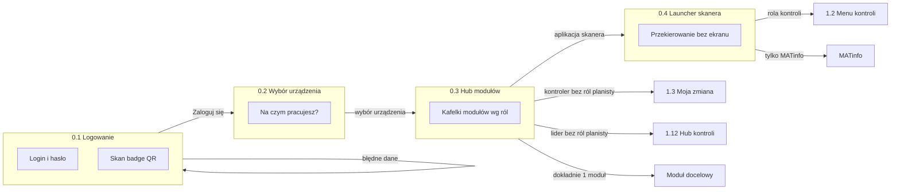
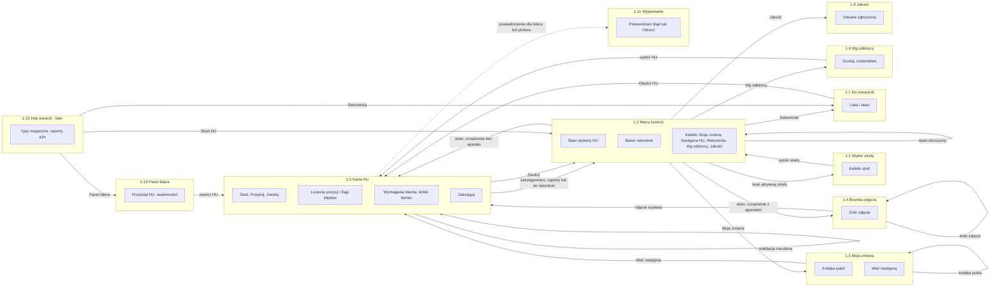
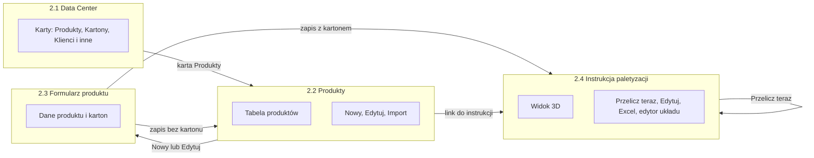
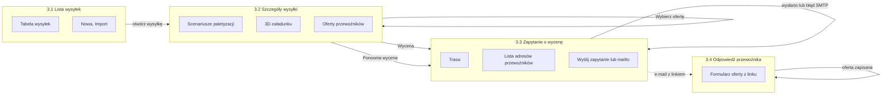

# 03. User flow — mapa ekranów

Dokumentacja analityczna LogViz: [01 Problem i zakres](01-problem-i-zakres.md) · [02 Proces](02-proces.md) ·
**03 User flow** · [04 Model danych](04-model-danych.md) ·
[05 Wymagania](05-wymagania.md) · [06 Decyzje](06-decyzje.md) · [07 Ograniczenia](07-ograniczenia.md)

Mapa odtworzona z widoków i szablonów. Każda akcja zapisująca to formularz POST z przekierowaniem,
a wynik pokazuje komunikat na następnym ekranie. Potwierdzenia na karcie HU (przejęcie, zwolnienie,
pilne) to systemowe okna `confirm()`, nie osobne ekrany.

## 0. Wejście wspólne: logowanie i hub

| Nr | Ekran | Elementy | Akcja użytkownika | Prowadzi do |
|---|---|---|---|---|
| 0.1 | Logowanie (`web/ui/views/misc.py:411`) | login, hasło, skan badge QR, „Nie pamiętasz hasła?” | Zaloguj się | 0.2 (raz na sesję) / 0.1 z błędem |
| 0.2 | Wybór urządzenia (`web/ui/views/misc.py:423`) | „Na czym pracujesz?”, kafelki typu urządzenia | wybór | strona docelowa (`next`) |
| 0.3 | Hub modułów (`web/ui/views/warehouse_search.py:12`) | kafelki modułów dozwolonych dla ról | klik kafla | moduł; kontroler → 1.3; lider → 1.12 |
| 0.4 | Launcher `/scan/` (`web/ui/views/warehouse_search.py:45`) | brak UI | — | 1.2 / MATinfo / wyszukiwarka magazynowa |

## 1. Kontrola HU na skanerze (flow główny)

| Nr | Ekran | Elementy | Akcja użytkownika | Prowadzi do |
|---|---|---|---|---|
| 1.1 | Wybór strefy (`web/huctl/views/hu_zone.py:59`) | kafelki stref, oznaczenie „AKTYWNA” | wybór strefy | 1.2 / 1.1 z komunikatem „Nie masz uprawnień do tej strefy.” |
| 1.2 | Menu kontroli (`web/huctl/views/hu_hub.py:182`) | pole skanu, baner rekontroli, kafelki | skan kodu | 1.4 / 1.5 / 1.2 z komunikatem |
| 1.2 | | | Moja zmiana / Rekontrola / Wg odbiorcy / Jakość | 1.3 / 1.7 / 1.6 / 1.8 |
| 1.3 | Moja zmiana (`web/huctl/views/hu_dashboard.py:44`) | kolejka, Weź następną, Status, zmień proces | Weź następną | 1.5 / 1.3 („Kolejka pusta”) / karta palety już w kontroli („dokończ ją”) |
| 1.4 | Bramka zdjęcia (`web/huctl/views/hu_hub.py:286`) | Zrób zdjęcie, Zrób ponownie | wysłanie zdjęcia | 1.5 / 1.4 z błędem |
| 1.5 | Karta HU (`web/huctl/views/hu_transaction_card.py:20`) | Start, Przejmij rezerwację/kontrolę, Zwolnij, Pilne (lider), Przynieś na strefę | Start | 1.5 |
| 1.5 | | kafelki jednostek, partia, flagi błędów, zdjęcie | Potwierdź pozycję | 1.5; przy rozbieżności prośba o ponowne liczenie lub „Tak, jestem pewien” |
| 1.5 | | Potwierdź wymagania, potwierdź krótki termin | potwierdzenie | 1.5 z komunikatem |
| 1.5 | | Zaksięguj (w PACZKI: kartony i paczki) | księgowanie | 1.2 z wynikiem / 1.5 z błędem walidacji |
| 1.5 | | Zwolnij | zgłoszenie braku palety | 1.2 |
| 1.5 | | Otwórz ponownie (lider, z powodem), Etykieta logistyczna | ponowne otwarcie | 1.5 |
| 1.6 | Wg odbiorcy (`web/huctl/views/hu_queue.py:288`) | odbiorca, typ magazynu, Szukaj, rodzeństwo | wybór HU | 1.5 |
| 1.7 | Do rekontroli (`web/huctl/views/hu_reports.py:54`) | skan, filtr typu, lista | Otwórz HU | 1.5 |
| 1.8 | Jakość (`web/huctl/views/hu_quality.py:31`) | lista otwartych zgłoszeń | zamknij (z opisem) / dołącz zdjęcie | 1.8 |
| 1.9 | Status (`web/huctl/views/hu_reports.py:99`) | postęp wg stref | filtr | 1.9 |
| 1.11 | Wyjaśnianie (`web/huctl/views/hu_investigation.py:108`) | kontekst błędu, 2 przyciski | Potwierdzam błąd / Odrzuć | przekierowanie z komunikatem |
| 1.12 | Hub kontroli (`web/huctl/views/hu_hub.py:16`) | typy magazynu, raporty, KPI, „wyjechało bez kontroli” | Zapisz wybór / linki | 1.12 / 1.13–1.16 / 1.2 |
| 1.13 | Panel lidera (`web/huctl/views/hu_leader.py:21`) | przydział, wiadomości, wyjaśnienia, wyjątki MD | przydziel / wyślij | 1.13 z komunikatem |

Pozostałe ekrany lidera: 1.14 Raport błędów (`web/huctl/views/hu_reports.py:198`), 1.15 KPI
(`web/huctl/views/hu_reports.py:350`), 1.16 Raport paczek (`web/huctl/views/hu_reports.py:17`),
1.17 Powiadomienia (`web/huctl/views/hu_quality.py:151`), 1.10 Historia HU (`web/huctl/views/hu_reports.py:76`).

## 2. Planista: Data Center → produkt → instrukcja paletyzacji

| Nr | Ekran | Elementy | Akcja użytkownika | Prowadzi do |
|---|---|---|---|---|
| 2.1 | Data Center (`web/ui/views/data_center.py:28`) | karty sekcji danych | klik „Produkty” | 2.2 |
| 2.2 | Produkty (`web/ui/views/products_crud.py:12`) | tabela, nowy/edytuj/usuń, import | Nowy / Edytuj / link instrukcji | 2.3 / 2.4 |
| 2.3 | Formularz produktu (`web/ui/views/products_crud.py:41`) | pola produktu i kartonu | Zapisz | 2.4 (z kartonem) / 2.2 |
| 2.4 | Instrukcja (`web/ui/views/instructions.py:112`) | 3D, Przelicz teraz, Edytuj, Excel, edytor układu | Przelicz / Edytuj | 2.4 z komunikatem |
| 2.5 | Instrukcja magazynowa `/i/<kod>/` (`web/ui/views/instructions.py:16`) | odczyt instrukcji | — | brak instrukcji → ekran „brak instrukcji” |

## 3. Wycena przesyłki

| Nr | Ekran | Elementy | Akcja użytkownika | Prowadzi do |
|---|---|---|---|---|
| 3.1 | Lista wysyłek (`web/transport/views/shipments_core.py:19`) | tabela, nowa, import, linki modułu | otwórz | 3.2 |
| 3.2 | Szczegóły (`web/transport/views/shipments_core.py:166`) | scenariusze, suwak efektywności, 3D, oferty, kierowca | Zapisz scenariusz / Wycena / Wybierz ofertę | 3.2 / 3.3 / 3.2 |
| 3.3 | Zapytanie o wycenę (`web/transport/views/quotes.py:156`) | trasa, odbiorcy, Wyślij / mailto | Wyślij zapytanie | 3.3 z komunikatem; e-mail → 3.4 |
| 3.4 | Odpowiedź przewoźnika (`web/transport/views/quotes.py:325`) | formularz oferty (bez logowania) | wyślij ofertę | 3.4 (zapisano / zablokowane) |

## 4. Ścieżki alternatywne

- Gość na chronionym adresie → logowanie z parametrem `next` → wybór urządzenia → adres docelowy.
- Zalogowany bez roli → strona 403 „Brak dostępu” (`web/core/roles.py:119`).
- „Weź następną”, gdy operator ma już paletę w kontroli → wraca na tę kartę
  (`web/huctl/views/hu_dashboard.py:16-20`).
- Przejęcie rezerwacji lub kontroli innego kontrolera (z powiadomieniem), zwolnienie palety
  („brak na lokalizacji”).
- Wyścigi: „HU została w międzyczasie zamknięta — liczenie anulowane.” (`web/huctl/views/hu_count.py:398`).
- Brak sieci na skanerze: zliczenia trafiają do kolejki w przeglądarce i są synchronizowane po
  powrocie sieci (`web/ui/templates/ui/scanner/base.html:480-600`); zaksięgowanie offline nie jest
  kolejkowane.
- Brak serwera poczty: zapytanie o wycenę przez link `mailto` (`web/transport/views/quotes.py:289-292`).
- Anulowana wysyłka blokuje wybór oferty (`web/transport/views/driver.py:22`).

## 5. Ślepe ścieżki (obserwacje)

1. **„Zwolnij” bez potwierdzenia sukcesu** — przekierowanie do menu bez komunikatu
   (`web/huctl/views/hu_queue.py:221-250`); operator nie wie, że alarm dotarł do lidera.
2. **„Start” kontroli bez komunikatu** — zmienia się tylko stan karty (`web/huctl/views/hu_transaction_card.py:172`).
3. **Bramka zdjęcia bez wyjścia** — ekran nie ma „wstecz” ani „pomiń”; przy niedziałającym aparacie
   kontrola tej palety na tym urządzeniu jest zablokowana (`web/huctl/views/hu_hub.py:252`).
4. **Wybór strefy bez „wstecz”** — użytkownik bez uprawnionej strefy krąży między 1.1 a komunikatem
   o braku uprawnień (`web/huctl/views/hu_zone.py:71`).
5. **Strona 403 dla operatora skanera** prowadzi do pulpitu planisty, a nie do menu skanera
   (`web/ui/templates/ui/403.html:18`).
6. **Ponowne liczenie „w ciemno” bez komunikatu** — wskazówką jest tylko przycisk „Tak, jestem pewien”
   (`web/huctl/views/hu_count.py:392-394`).
7. **Odpowiedź przewoźnika w stanie „zablokowane”** nie podaje dalszego kroku (celowo bez nawigacji —
   użytkownik zewnętrzny).
