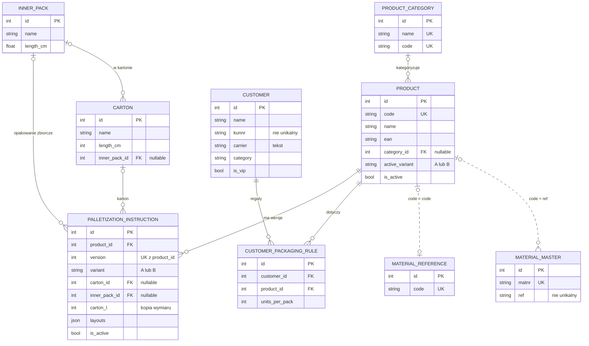
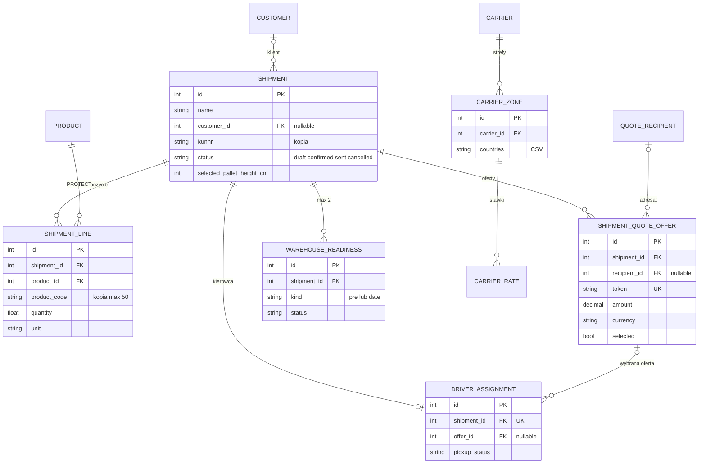
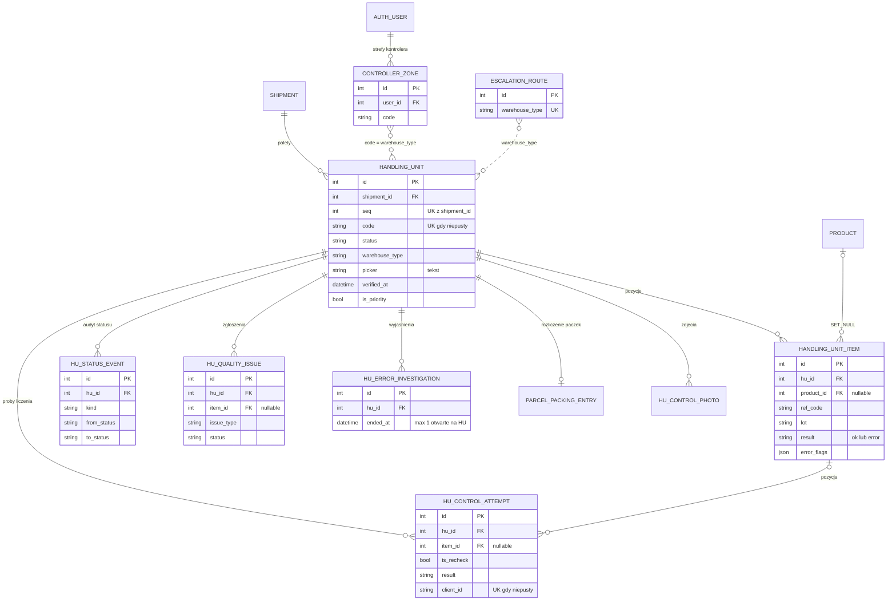
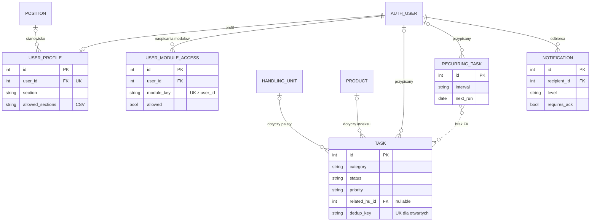

# 04. Model danych

Dokumentacja analityczna LogViz: [01 Problem i zakres](01-problem-i-zakres.md) · [02 Proces](02-proces.md) ·
[03 User flow](03-user-flow.md) · **04 Model danych** ·
[05 Wymagania](05-wymagania.md) · [06 Decyzje](06-decyzje.md) · [07 Ograniczenia](07-ograniczenia.md)

Model odtworzony z definicji modeli Django: 75 konkretnych modeli w aplikacjach `ui`
(`web/ui/models/`), `huctl` (`web/huctl/models_hu.py`, `web/huctl/models_control.py`) i `transport`
(`web/transport/models_shipment.py`, `web/transport/models_quoting.py`). Poniżej encje główne.
Linia przerywana (`..`) na diagramie oznacza powiązanie **logiczne** — przez równość napisów, bez
klucza obcego w bazie.

## 1. Katalog, pakowanie i klienci

| Encja | Opis | Kod |
|---|---|---|
| Product | Indeks (produkt) z unikalnym kodem; aktywny wariant instrukcji A lub B; historia zmian | `web/ui/models/catalog.py:72-141` |
| PalletizationInstruction | Wersjonowana instrukcja ułożenia kartonów na palecie EU; przechowuje własną kopię wymiarów kartonu | `web/ui/models/packaging.py:222-375` |
| Carton / InnerPack | Karton i opakowanie zbiorcze (OPZ) z wymiarami i wagą | `web/ui/models/packaging.py:7` (InnerPack), `:40` (Carton) |
| MaterialReference / MaterialMaster | Dane referencyjne z eksportów SAP (MARM, dane materiałowe) — bez klucza obcego do Product | `web/ui/models/catalog.py:144-164`, `web/ui/models/material_master.py:13-45` |
| Customer | Klient lub odbiorca z wymaganiami dostawy (max wysokość/waga palety, min. ważność, etykieta, VIP) | `web/ui/models/customers.py:5-124` |
| CustomerPackagingRule | Reguła pakowania klient × indeks (ile sztuk w opakowaniu) | `web/ui/models/customers.py:127-153` |

## 2. Wysyłki i wycena

| Encja | Opis | Kod |
|---|---|---|
| Shipment | Wysyłka; status zmieniany tylko przez tabelę przejść w kodzie | `web/transport/models_shipment.py:13-277`, przejścia `:211-225` |
| ShipmentLine | Pozycja wysyłki: produkt, ilość, jednostka (szt/kar/pal) | `web/transport/models_shipment.py:280-328` |
| ShipmentQuoteOffer | Oferta przewoźnika złożona przez link z tokenem; jedna na parę wysyłka × adresat | `web/transport/models_quoting.py:57-111` |
| DriverAssignment | Dane kierowcy i potwierdzenie odbioru (1:1 z wysyłką) | `web/transport/models_quoting.py:114-139` |
| WarehouseReadiness | Zapytanie do magazynu o gotowość (rodzaj „pre” albo „date”) | `web/transport/models_quoting.py:143-184` |
| Carrier / CarrierZone / CarrierRate | Cennik przewoźników (strefy krajów, przedziały wagowe) — zob. [07](07-ograniczenia.md) | `web/transport/models_quoting.py:18-35, 187-211` |

## 3. Kontrola HU

| Encja | Opis | Kod |
|---|---|---|
| HandlingUnit | Paleta w kontroli: kod HU, status, typ magazynu, rezerwacja, priorytet | `web/huctl/models_hu.py:11-161` |
| HandlingUnitItem | Pozycja palety: indeks, partia, data ważności, oczekiwana i policzona ilość, wynik | `web/huctl/models_hu.py:169-231` |
| HUStatusEvent | Ślad zmian statusu, rezerwacji i zwolnień (kto, kiedy, dlaczego) | `web/huctl/models_control.py:117-139` |
| HUControlAttempt | Każda próba liczenia: ilość, źródło wpisu (skan/klawiatura/offline), urządzenie | `web/huctl/models_control.py:50-90` |
| HUQualityIssue | Zgłoszenie jakościowe (uszkodzenie, obcy towar, …), otwarte lub zamknięte | `web/huctl/models_control.py:12-47` |
| HUErrorInvestigation | Wyjaśnianie błędu (wstrzymuje licznik KPI) | `web/huctl/models_control.py:259-321` |
| ParcelPackingEntry | Rozliczenie strefy PACZKI: kartony, paczki, objętość | `web/huctl/models_control.py:142-164` |
| ControllerZone / EscalationRoute | Uprawnienia kontrolera do typów magazynu; adresaci eskalacji | `web/huctl/models_control.py:199` (ControllerZone), `:167` (EscalationRoute) |

## 4. Użytkownicy, zadania i powiadomienia

| Encja | Opis | Kod |
|---|---|---|
| UserProfile | Profil użytkownika (sekcja, dozwolone strefy, preferencje) tworzony automatycznie | `web/ui/models/tasks_users.py:137-220` |
| UserModuleAccess | Indywidualne włączenie/wyłączenie modułu dla użytkownika | `web/ui/models/tasks_users.py:277-294` |
| Task / RecurringTask | Zadanie (ręczne, z niezgodności stocku, naprawcze HU, …) i szablon zadania cyklicznego | `web/ui/models/tasks_users.py:4-84, 223-242` |
| Notification | Powiadomienie w aplikacji, opcjonalnie z wymaganym potwierdzeniem odczytu | `web/ui/models/comms.py:41-65` |

Dane magazynowe (snapshoty stanów, układ hali, master lokalizacji, aktywność pickerów) są w
`web/ui/models/warehouse_data.py` i łączą się z resztą wyłącznie przez napis `location_code`
(docstring modułu, l. 1-5).

## 5. Reguły integralności wymuszane przez bazę

| Reguła | Kod |
|---|---|
| Kod produktu unikalny | `web/ui/models/catalog.py:73` |
| Jedna wersja instrukcji na (produkt, wersja) | `web/ui/models/packaging.py:293` |
| Jedna reguła pakowania na (klient, produkt) | `web/ui/models/customers.py:148` |
| Paleta o statusie „zgodny” musi mieć datę weryfikacji (CHECK) | `web/huctl/models_hu.py:89-91` |
| Kod HU unikalny, jeśli niepusty | `web/huctl/models_hu.py:94-95` |
| Numer palety unikalny w wysyłce | `web/huctl/models_hu.py:84` |
| Jedno otwarte zgłoszenie jakościowe na (HU, pozycja, typ) | `web/huctl/models_control.py:41-43` |
| Najwyżej jedno otwarte wyjaśnianie na HU | `web/huctl/models_control.py:289-290` |
| Idempotencja synchronizacji offline: `client_id` próby unikalny, jeśli niepusty | `web/huctl/models_control.py:84-86` |
| Jedna oferta na (wysyłka, adresat); token oferty unikalny | `web/transport/models_quoting.py:65, 89` |
| Najwyżej 2 zapytania o gotowość na wysyłkę (pre, date) | `web/transport/models_quoting.py:176` |
| Jedno otwarte zadanie na klucz deduplikacji | `web/ui/models/tasks_users.py:75-78` |

## 6. Niespójności (obserwacje)

Miejsca, w których kod zakłada regułę, a baza jej nie wymusza. Bez propozycji poprawek.

1. **Typ magazynu jako klucz tekstowy o różnej długości** — od 10 do 50 znaków w różnych tabelach
   (`web/ui/models/warehouse_data.py:28, 145`, `web/huctl/models_hu.py:33`, `web/huctl/models_control.py:171, 207`).
   Literówka po cichu wyłącza uprawnienia strefowe i eskalację.
2. **Kod lokalizacji bez klucza obcego** — wiąże kilka tabel tylko napisem (`web/ui/models/warehouse_data.py:4`).
3. **Kod produktu kopiowany i obcinany do 50 znaków** przy pozycji wysyłki, choć kod może mieć 100
   (`web/transport/models_shipment.py:317`, `web/ui/models/catalog.py:73`).
4. **Przewoźnik klienta to wolny tekst**, nie powiązanie z modelem przewoźnika (`web/ui/models/customers.py:32`).
5. **Najwyżej jedna wybrana oferta na wysyłkę** pilnowana tylko w widoku (`web/transport/views/driver.py:37-40`),
   nie w bazie (`web/transport/models_quoting.py:81`).
6. **Numer klienta (KUNNR) nie jest unikalny**, a import palet dopasowuje klienta po tym numerze —
   przy duplikatach wygrywa ostatni (`web/ui/models/customers.py:39`, `web/huctl/hu_import.py:55-56`).
7. **Przejścia statusu palety rozproszone** w co najmniej 6 modułach widoków; baza wymusza tylko
   „zgodny ⇒ data weryfikacji” (`web/huctl/views/hu_helpers.py:436`, `web/huctl/views/hu_transaction_final.py:142-261`).
8. **Instrukcja paletyzacji ma własne wymiary kartonu** obok klucza obcego do kartonu — po edycji
   kartonu mogą się rozjechać (`web/ui/models/packaging.py:234, 251-257`).
9. **Usunięcie wysyłki kasuje kaskadowo całą historię kontroli HU** (`web/huctl/models_hu.py:24`) —
   zob. [07](07-ograniczenia.md).
10. **Niespójne skutki usunięcia pozycji palety** — próby liczenia zostają, zgłoszenia jakościowe znikają
    (`web/huctl/models_control.py:19, 55`).
11. **Ten sam produkt nie może wystąpić w jednej wysyłce w dwóch jednostkach** (unikalność wysyłka ×
    produkt, `web/transport/models_shipment.py:328`).
12. **Pola słownikowe bez listy dozwolonych wartości**: wynik próby liczenia, waluta oferty, akcja audytu
    dostępu (`web/huctl/models_control.py:66`, `web/transport/models_quoting.py:67`, `web/ui/models/tasks_users.py:301`).
