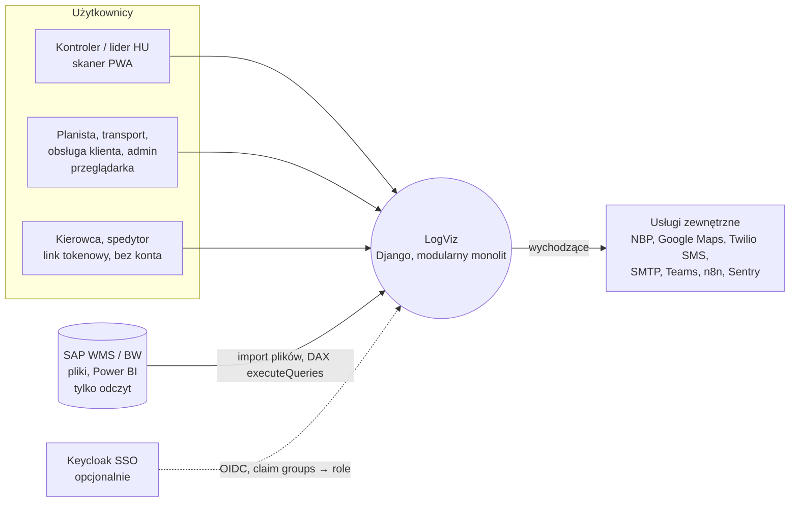
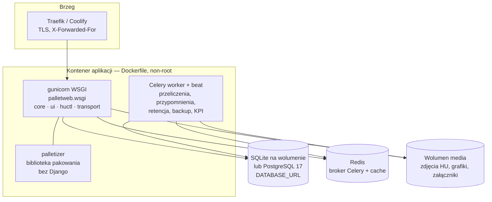

# Architektura — kontekst i kontenery (C4)

**Status:** [DEV] 2026-10-16, wersja 0.1. Kanoniczny opis platformy (hub modułów, marka,
konwencje strukturalne, zamrożone kontrakty) to [`ARCHITECTURE.md`](../../ARCHITECTURE.md) w
korzeniu repo; decyzje — [`docs/adr/`](../adr/README.md). Ten dokument dodaje diagramy C4 (poziom
1 i 2), których tam nie ma, i nie powiela treści.

## 1. Kontekst systemu

## 2. Kontenery (jeden VPS, Coolify)

Granice i kontrakty: `core` (shared kernel bez modeli) ↔ domeny `ui`/`huctl`/`transport`
(strażnik `web/ui/tests/test_module_boundaries.py`); wszystkie URL-e w przestrzeni `ui:`
(`web/ui/tests/test_urls_snapshot.py`); nazwy grup ról zamrożone (ADR-0006).

## 3. Przepływy wrażliwe (odsyłacze)

| Przepływ | Gdzie opisany |
|---|---|
| Logowanie, SSO, reset hasła | `docs/bezpieczenstwo/THREAT_MODEL.md` F1 |
| Skaner ↔ serwer, synchronizacja offline (`/control/sync/`) | THREAT_MODEL F2 |
| Formularze tokenowe bez konta | THREAT_MODEL F3 |
| Importy plików i zdjęcia | THREAT_MODEL F4 |
| REST API `X-API-Key` | [API.md](API.md), THREAT_MODEL F5 |
| Integracje wychodzące | THREAT_MODEL F6 |

## 4. Kierunek

Obowiązuje ADR-0001 (monolit modularny). `ARCHITECTURE-MICROSERVICES.md` (strangler fig) jest
propozycją bez statusu decyzji — założenie A-08 w `docs/analiza/ZALOZENIA.md`.
