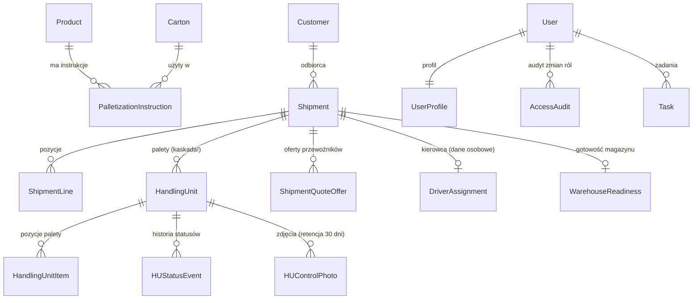

# Model danych

**Status:** [DEV] 2026-10-16, wersja 0.1. Pełne diagramy ER, encje, reguły integralności wymuszane
przez bazę i 12 obserwowanych niespójności są w [`docs/04-model-danych.md`](../04-model-danych.md)
(kanon). Tu: mapa pakietów modeli i encje rdzenia, żeby wiedzieć, gdzie szukać.

## 1. Gdzie żyją modele

| Aplikacja | Pliki | Domeny |
|---|---|---|
| `ui` | `web/ui/models/` (pakiet): `catalog`, `packaging`, `packspec`, `customers`, `warehouse`, `warehouse_data`, `carton_opt`, `comms`, `tasks_users`, `integrations` | produkty, kartony, instrukcje, klienci, stock, snapshoty SAP, zadania, użytkownicy, audyt |
| `huctl` | `web/huctl/models_hu.py`, `models_control.py` (fasada `models.py`) | palety HU, pozycje, próby liczenia, zdjęcia, zgłoszenia jakościowe, strefy kontrolerów |
| `transport` | `web/transport/models_shipment.py`, `models_quoting.py` | wysyłki, pozycje, przewoźnicy, oferty, kierowca, gotowość magazynu |

Łącznie 74 modele; 208 migracji (`ui` 200). Historia zmian: `django-simple-history` na wybranych
modelach. Migracje: expand → contract (ADR-0017).

## 2. Encje rdzenia (uproszczone)

Uwaga „kaskada!”: usunięcie wysyłki kasuje palety i całą historię kontroli (P8, `docs/04` §6 pkt 9)
— kandydat do zmiany na archiwizację (PROCESY.md T6).

## 3. Klasyfikacja danych w modelu

Które pola są danymi osobowymi lub poufnymi — `docs/bezpieczenstwo/KLASYFIKACJA_DANYCH.md`.
