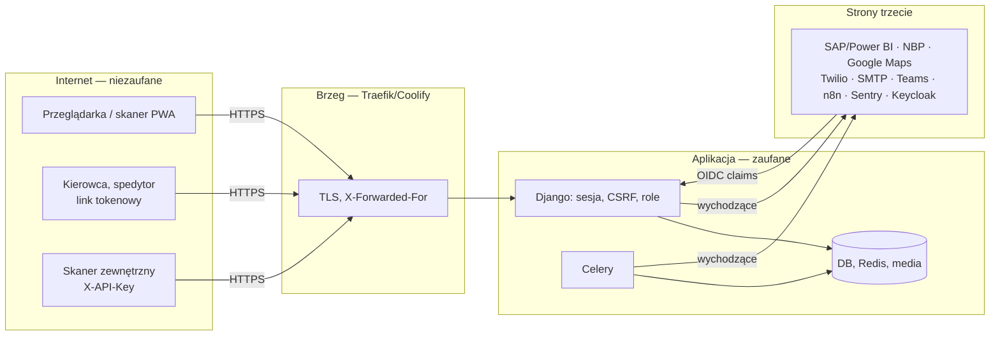

# Model zagrożeń (STRIDE) — wersja 0.1

**Status:** [SEC] 2026-10-16. Oparty na kodzie i konfiguracji w repo; stan serwera (firewall,
TLS, panel Coolify, SSH) pozostaje pytaniami V1–V8 w `docs/deploy-hardening-audit.md` (A-14).
Ryzyka z kolumny „Luka” mają wpisy w [RYZYKA.md](RYZYKA.md). Legenda STRIDE: S podszywanie ·
T manipulacja · R wyparcie się · I ujawnienie · D odmowa usługi · E podniesienie uprawnień.

## 1. Granice zaufania

## 2. Przepływy i zagrożenia

### F1 — Logowanie, sesja, SSO, reset hasła

| Zagrożenie | STRIDE | Istniejące zabezpieczenie (dowód) | Luka → ryzyko |
|---|---|---|---|
| Zgadywanie haseł, credential stuffing | S | django-axes 5 prób/1 h per (login, IP), prawdziwe IP zza proxy (`settings.py` AXES_*, `web/core/middleware.py:client_ip`); polityka min. 8 znaków | brak MFA dla administratorów → **R-04** |
| Przejęcie sesji na wspólnym skanerze | S | sesja 8 h rolling, cookies `Secure`/`HttpOnly`/`SameSite=Lax`, wylogowanie | — |
| Zalewanie resetu hasła | D/I | 5 POST/h per IP i 3/h per e-mail (`web/core/ratelimit.py`) | — |
| Rola nadana w IdP nie odebrana lokalnie | E | SSO synchronizuje grupy przy każdym logowaniu (`ui/oidc.py:_sync_roles`); użytkownik bez grup nie jest tworzony | — |
| Wyparcie się zmiany ról | R | `AccessAudit` (kto, komu, co) | — |

### F2 — Skaner ↔ serwer, synchronizacja offline (`/control/sync/`)

| Zagrożenie | STRIDE | Zabezpieczenie | Luka → ryzyko |
|---|---|---|---|
| Wpis ręczny udający skan | T | znacznik źródła wpisu, bramka `HU_SCAN_ENFORCE` (ADR-0012) | bramka domyślnie wyłączona (decyzja właściciela) |
| Powtórna synchronizacja tego samego zliczenia | T | idempotencja (FR-HU-38), te same bramki co online | — |
| Liczenie palety przez osobę, która jej nie trzyma | E | bramka „inny kontroler” przy liczeniu | nie sprawdzane przy księgowaniu (P5) → **R-09** (decyzja US-012) |
| Zdjęcie dowodowe podmienione / nieprawdziwe | T/R | zdjęcie wymagane przy flagach jakości, sprawdzane po zawartości (`phv_data.py`, `hu_helpers.py:30`) | — |

### F3 — Formularze tokenowe bez konta (kierowca, spedytor, gotowość magazynu)

| Zagrożenie | STRIDE | Zabezpieczenie | Luka → ryzyko |
|---|---|---|---|
| Zgadywanie tokenu | S | uuid4 (122 bity), 404 przy braku | — |
| Wyciek tokenu z logów / historii przeglądarki / przekazanego maila | I/S | — | token w ścieżce URL w logu dostępowym gunicorn/Traefik, brak TTL dla ofert i gotowości → **R-07** |
| Zalewanie formularza, relay SMS | D | 20 POST/h/token, SMS tylko do numeru z przypisania (`driver.py:16,184`) | — |
| Złośliwy załącznik oferty | T/E | PDF/JPG/PNG po nagłówku i rozszerzeniu, ≤ 30 MB, serwowany jako załącznik z `nosniff` | bez sprawdzenia magic bytes → **R-07/R-08** |

### F4 — Importy plików i uploady (Excel/CSV SAP, zdjęcia, grafiki, modele GLB)

| Zagrożenie | STRIDE | Zabezpieczenie | Luka → ryzyko |
|---|---|---|---|
| Wyczerpanie dysku dużym plikiem | D | limity 5–30 MB w 13 widokach | `glb_model` produktu bez limitu; brak limitu globalnego → **R-08** |
| Stored XSS przez upload (SVG/HTML) | T | `media_serve`: nie-rastry jako załącznik, `nosniff`; zdjęcia sprawdzane po zawartości | — |
| Zatrucie master daty błędnym importem | T | import nie zmienia palety w kontroli (FR-HU-03), raport błędów importu | brak podpisu/pochodzenia pliku SAP — akceptowane (ADR-0003) |
| Path traversal w nazwie pliku | T | Django `FileField` + `upload_to`, losowy prefiks grafik | — |

### F5 — REST API `X-API-Key`

| Zagrożenie | STRIDE | Zabezpieczenie | Luka → ryzyko |
|---|---|---|---|
| Kradzież klucza | S/I | klucz w env, logi bez tokenu, rotacja bez przestoju (`PALVIZ_API_TOKENS`) | klucz bezterminowy, bez IP allowlist — akceptowane przy zakresach |
| Nadmierne uprawnienia klienta | E | zakresy per klient, fail-closed (`api_auth.py`) | klient `legacy` ma pełny dostęp — przejść skanery na klientów nazwanych |
| Timing attack na porównaniu | I | `hmac.compare_digest` ze wszystkimi tokenami | — |
| Zalewanie API | D | 120/min per klucz | — |
| Enumeracja endpointów | I | `/docs` tylko dla staff | — |

### F6 — Integracje wychodzące (Power BI, NBP, Google Maps, Twilio, SMTP, Teams, n8n, Sentry)

| Zagrożenie | STRIDE | Zabezpieczenie | Luka → ryzyko |
|---|---|---|---|
| MITM do Power BI | I | TLS; `POWERBI_CA_BUNDLE` dla korporacyjnego proxy | `POWERBI_SSL_VERIFY=false` możliwe na prod → **R-10** |
| Wyciek danych osobowych do Sentry | I | `send_default_pii=False`, bez zmiennych lokalnych | — |
| Zawieszony dostawca blokuje workery | D | timeouty (SMTP 20 s, NBP 4 s + cache awarii B-011), limity zadań Celery | — |
| Fałszywe zdarzenia do n8n / z n8n | S | sekret w nagłówku `X-N8N-Secret` (wychodzące) | przychodzących webhooków brak — nie dotyczy |

### F7 — Panel administracyjny i konfiguracja

| Zagrożenie | STRIDE | Zabezpieczenie | Luka → ryzyko |
|---|---|---|---|
| Przejęcie konta admina | S/E | hasło + axes; `AccessAudit` | brak MFA, `/admin/` publiczny → **R-04** |
| Start produkcji ze słabym kluczem / ujawnienie wartości env w błędzie | I/T | odrzucenie klucza deweloperskiego; walidacja typów przy starcie | słaby klucz przechodzi; `input_value` w komunikacie → **R-06** |
| Sekret w repozytorium | I | `.env.example` z placeholderami, gitleaks | gitleaks tylko tygodniowo → **R-01** |
| Podatna zależność na produkcji | E/T | wersje przypięte, obraz przypięty digestem | SCA informacyjne i tygodniowe, brak Dependabota → **R-01/R-09** |

### F8 — Dane w spoczynku, kopie, demo

| Zagrożenie | STRIDE | Zabezpieczenie | Luka → ryzyko |
|---|---|---|---|
| Utrata danych (awaria dysku, ransomware) | D | zadanie `ui.run_backup`, runbook odtworzenia | backup wyłączony, kopia na tym samym hoście → **R-03** |
| Dane osobowe trzymane bezterminowo | I | zadanie `ui.gdpr_retention`, zdjęcia HU 30 dni | retencja kierowców/logów = 0 → **R-02** |
| Wandalizm na instancji demo | T/D | konto demo tylko do odczytu, nocny reset, `demo_login` tylko w `DEMO_MODE` | — |
| Dostęp do mediów bez logowania | I | ACL-001 w `media_serve` (B-002 naprawione) | publiczne tylko `quotes/` i `site/` (świadomie) |

## 3. Co nie jest objęte tą wersją

Fizyczne bezpieczeństwo skanerów, sieć WiFi hali, SAP i Power BI po stronie dostawcy, proces
nadawania kont w HR. Do uzupełnienia po odpowiedziach PO (V1–V8, A-14).
